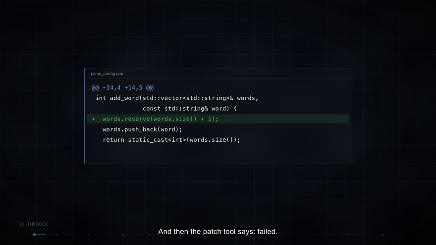
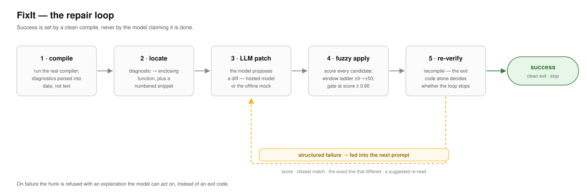
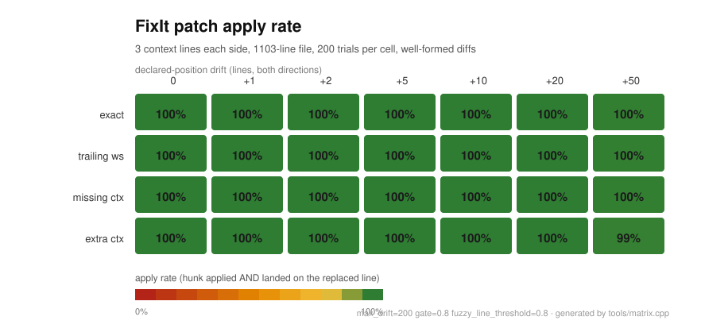
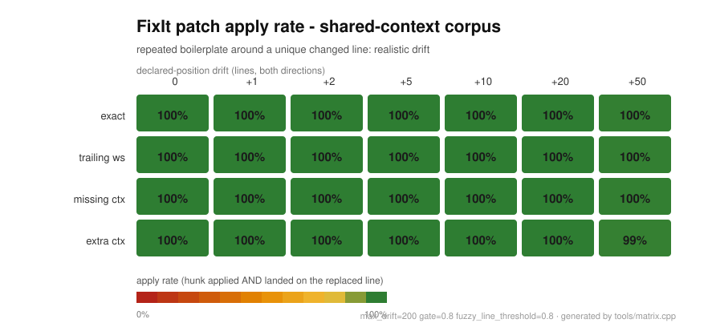
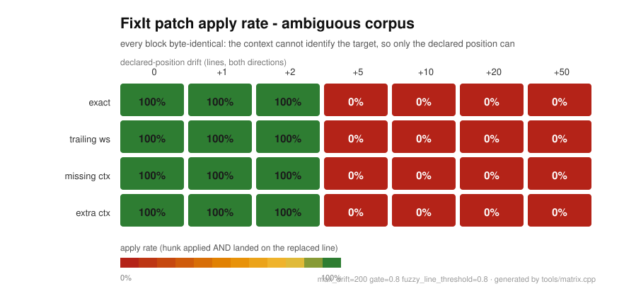

> **English** | [繁體中文](README.zh-TW.md)

# FixIt

[](https://github.com/wong060404/FixIt/actions/workflows/ci.yml)
[](#53-requirements)
[](LICENSE)

**A C++ library + CLI that closes the loop between compiler output and an LLM's
patches: compile → locate → LLM patch → fuzzy apply → re-verify.**

FixIt is not another wrapper around `patch(1)`. Its patch engine is built for the
patch a model *actually produces* — one with drifted line numbers, missing
context, and whitespace that does not quite match — and when a patch cannot be
applied it returns a structured explanation the model can act on, instead of an
exit code.

**The demo is one command.** On Windows, after cloning:

```powershell
.\setup.cmd                     # once per machine: compiler, build, `fixit` on PATH

# in a NEW terminal (setup cannot change the PATH of this window):
fixit.cmd examples\buggy\e1_missing_include.cpp --agent --llm mock --verbose --no-write
```

### See it working

[](docs/fixit_intro_subs.mp4)

**▶ [Watch the full 4-minute introduction](docs/fixit_intro_subs.mp4)** · [English subtitles](docs/fixit_intro.srt)

### Documentation

Every prose document in this repository exists in English and Traditional Chinese
(`.zh-TW`).

| Document | English | 繁體中文 |
|---|---|---|
| This README (motivation, innovation, use cases, setup, usage) | [README.md](README.md) | [README.zh-TW.md](README.zh-TW.md) |
| Getting started on Windows: clone → build → run → repair a file | [WINDOWS-SETUP.md](WINDOWS-SETUP.md) | [WINDOWS-SETUP.zh-TW.md](WINDOWS-SETUP.zh-TW.md) |
| Design decisions (ADRs 001–037) | [docs/decisions.md](docs/decisions.md) | [docs/decisions.zh-TW.md](docs/decisions.zh-TW.md) |
| Wiki outline | [docs/wiki_outline.md](docs/wiki_outline.md) | [docs/wiki_outline.zh-TW.md](docs/wiki_outline.zh-TW.md) |
| Compiler fixtures | [tests/fixtures/compiler/README.md](tests/fixtures/compiler/README.md) | [tests/fixtures/compiler/README.zh-TW.md](tests/fixtures/compiler/README.zh-TW.md) |
| Recorded demo transcript | [docs/demo_output.txt](docs/demo_output.txt) | — (byte-exact program output, asserted by the test suite) |
| Introduction video (4 min, subtitled) | [docs/fixit_intro_subs.mp4](docs/fixit_intro_subs.mp4) | — (English subtitles: [docs/fixit_intro.srt](docs/fixit_intro.srt)) |

---

## 1. Motivation

Agentic C++ repair has one bottleneck that is **not** the model: **the patch does
not apply.**

A model writes a perfectly reasonable edit:

```diff
--- a/parse.cpp
+++ b/parse.cpp
@@ -14,4 +14,5 @@
   for (const auto& w : words) {
     count += w.size();
+    seen.insert(w);
   }
```

The fix is correct. But the file changed since the model last read it, so the real
code is two lines further down. `patch(1)` and friends do the reasonable thing —
they refuse the whole diff — and the model never learns *why*. It guesses again,
burns another round, and the repair loop spins.

| Failure | What existing tools do | What the loop needs |
|---|---|---|
| **Line drift** — `@@` numbers are stale | reject the hunk | find the hunk by its content |
| **Missing context** — the model quotes fewer lines | reject the hunk | score what it did quote |
| **Whitespace noise** — trailing spaces, CRLF | reject the hunk | treat it as a match |
| **Refusal itself** — an exit code is not explainable | *nothing* | say which line differed, and what to re-read |

The last row is the important one. A `1` exit code teaches a model nothing; a
sentence like *"expected line 15 to contain `return x;` but the file has
`return 0;` — re-read lines 12–18"* teaches it everything.

FixIt closes that circle:

| Step | What FixIt does |
|---|---|
| compile | runs the real compiler, parses diagnostics into data (not text) |
| locate | maps a diagnostic to its enclosing function and a numbered snippet |
| patch | scores every plausible position with a sliding window and applies the best one |
| re-verify | recompiles; only the compiler decides whether the repair worked |
| on failure | returns `score`, the closest match, the exact line that differed, and a suggested re-read |



---

## 2. Innovation

1. **A fuzzy patch engine for model-written diffs.** Every candidate position is
   scored (`exact`/`fuzzy`/`mismatch`, normalised so a perfect hunk is `1.00`),
   searched through the window ladder `±0 → ±1 → ±2 → ±5 → ±10 → ±50 → global`, and
   gated at `score ≥ 0.80` **and** at least one exactly-matching line. Line drift,
   missing context and trailing-whitespace differences all apply anyway.
2. **Structured failure that feeds the loop.** A refused hunk yields `score 0.55 <
   gate 0.80 … expected line 14 to contain 'return x;' but the file has 'return
   0;'. Closest match at line 15 … re-read lines 12-18` — text designed to be
   pasted straight back into the next prompt.
3. **The compiler is the only ground truth.** A model that answers `FINAL` still
   triggers a compile; `success` is set only by a clean exit, and only when the
   compiler actually ran. The mock rules, the trace format and the CLI all read
   from that one source.
4. **Hostile-environment hardening.** Compiler flags are *probed*, never assumed
   (`-ferror-limit` does not exist in GCC and made it abort silently); diagnostics
   are normalised across clang/GCC; paths are UTF-8 from `argv` to the filesystem
   (Chinese file names and Chinese checkout paths work — ADR-037); a CRLF file
   stays uniformly CRLF after an edit.
5. **A library, not just a tool.** `libfixit` installs and exports as
   `FixIt::fixit`; a CI bot can link `Compiler` + `PatchEngine`, an editor can use
   `CodeMap`, and an agent product can take the whole `Agent`.

---

## 3. Example use cases

### 3.1 A student debugging their own file

FixIt runs the real compiler and maps each error to its enclosing function, plus a
numbered snippet — no model, no network:

```powershell
fixit.cmd lab3.cpp
fixit.cmd lab3.cpp --outline          # structure only: functions, includes, syntax errors
```

### 3.2 Repairing a file that does not compile

Start with `--no-write` so the original is untouched, then drop the flag once the
intended change looks right:

```powershell
fixit.cmd lab3.cpp --agent --llm mock --verbose --no-write
fixit.cmd lab3.cpp --agent --llm openai --base-url http://127.0.0.1:11434/v1 `
          --model qwen2.5-coder:7b --api-key ollama
```

### 3.3 A CI repair bot

The exit code is the contract; `--trace` and `--metrics` record what was tried:

```bash
./build/bin/fixit src/parser.cpp -Iinclude --agent --llm mock --no-write
case $? in
  0) echo "build fixed automatically" ;;
  1) echo "still broken — failing the job"; exit 1 ;;
esac
```

### 3.4 An editor or IDE plugin

`CodeMap` needs neither a compiler nor a model:

```cpp
#include <fixit/codemap.h>

fixit::CodeMap map("src/parser.cpp");
auto fn = map.enclosing_function(14, 5);   // innermost function containing the caret
if (fn) show_tooltip(fn->name, fn->start_line, fn->end_line);
```

### 3.5 An LLM agent that needs a reliable edit tool

Reuse the engine and hand the model a structured answer instead of a shell exit
code:

```cpp
#include <fixit/patch.h>

fixit::PatchEngine engine;
fixit::PatchResult r = engine.apply(file_content, model_diff, "parser.cpp");
if (!r.all_applied) return ask_again(r.failure_summary());  // score, gate, closest match
```

The repository ships this as a complete consumer: [`examples/consumer/`](examples/consumer/).

### 3.6 Measuring a model's patch quality

`./build/bin/fixit-matrix` sweeps controlled imperfections and prints a success
rate per cell — the numbers in [§8.2](#82-measured-patch-tolerance) — which makes it
a ready-made benchmark for any model's diffs.

---

## 4. Demo in 60 seconds

For the recorded transcript see [§4.1](#41-recorded-transcript-byte-reproducible); this
is the live sequence used in the presentation.

```powershell
# 0. setup, once: finds a compiler, builds, registers `fixit`
.\setup.cmd

# 1. show the problem: e1 does not compile (two planted bugs)
fixit.cmd examples\buggy\e1_missing_include.cpp

# 2. let the loop repair it; watch the fuzzy apply in iteration 2
fixit.cmd examples\buggy\e1_missing_include.cpp --agent --llm mock --verbose --no-write

# 3. the honest case: e3 is outside the mock's rules, so it stays unfixed (exit 1)
fixit.cmd examples\buggy\e3_type_error.cpp --agent --llm mock --no-write
```

What to point at while it runs: the declared hunk position is one line off and the
engine still lands it (`fuzzy, drift-1`); the final `✓ clean` comes from a real
recompile, not from the model's opinion; and `Not fixed` is a first-class outcome,
not a crash.

### 4.1 Recorded transcript (byte-reproducible)

The full transcript, with all three examples and every diagnostic, is
[`docs/demo_output.txt`](docs/demo_output.txt). One recording:

```
$ fixit e1_missing_include.cpp --agent --llm mock --verbose --compiler clang++

══ FixIt v0.1.0 · agent mode (mock) ══

── iteration 1 ----------------------------
$ clang++ -fsyntax-only e1_missing_include.cpp
  ✗ 5 errors
    [E1]   L10   expected ';' at end of declaration
    [E2]   L14   no member named 'vector' in namespace 'std'
    [E3]   L14   expected '(' for function-style cast or type construction
    [E4]   L14   use of undeclared identifier 'words'
    [E5]   L14   expected expression
  → context: fn parse_count() [L9–L12]
  → patch…
    ✓ hunk 1 @ L8    (exact)
── iteration 2 ----------------------------
$ clang++ -fsyntax-only e1_missing_include.cpp
  ✗ 1 error
    [E1]   L11   expected ';' at end of declaration
  → context: fn parse_count() [L10–L13]
  → patch…
    ✓ hunk 1 @ L11   (fuzzy, drift-1)
$ clang++ -fsyntax-only e1_missing_include.cpp
  ✓ clean
✔ Fixed 5 errors in 2 iterations
```

The two hunks are the two planted bugs: a missing semicolon (line 10) and a
`<vector>` that was never included. The first lands exactly; the second is declared
one line off and the window search finds it anyway. `e2_drift.cpp` carries the same
two bugs 37 lines further down, so *both* declared positions are wrong and the
search still repairs it. `e3_type_error.cpp` is deliberately outside the mock's
rule set: the loop reports it unfixed (exit `1`) rather than pretending.

The transcript is regenerated by [`tools/record_demo.sh`](tools/record_demo.sh) and
is byte-reproducible (`--no-timing`, `NO_COLOR=1`), so CI can diff it.

---

## 5. Setup

### 5.1 Windows — zero setup (recommended)

```powershell
git clone https://github.com/wong060404/FixIt.git
cd FixIt
.\setup.cmd        # once per machine; idempotent and reversible

# open a new terminal, then (from any folder):
fixit.cmd examples\buggy\e1_missing_include.cpp --agent --llm mock --verbose --no-write
```

`setup.cmd` finds a compiler (six places, including an installed MSYS2), or offers
`-FetchToolchain` to download a portable MinGW-w64 GCC once; builds into the
git-ignored `build-win\` (reusing an up-to-date build); registers `fixit` on the
**user** `PATH` (falling back to a shim in `%LOCALAPPDATA%\Microsoft\WindowsApps`
when the registry is not writable); and verifies the result. It installs nothing
system-wide and copies nothing into your projects; `install-command.ps1 -Remove`
undoes the registration. A child process cannot change the `PATH` of the window it was
started from, so open a new terminal after setup — or keep using `.\fixit.cmd` from inside
the checkout.

After setup, `fixit.cmd <file>` works from **any** folder. The argument is resolved
for you too — all of these reach the same file:

```powershell
fixit.cmd "C:\work\lab3.cpp"        # exact path
fixit.cmd lab3.cpp                    # bare name in Downloads / Desktop / Documents
fixit.cmd Downloads\lab3.cpp          # relative to your home folder
fixit.cmd '~/Downloads/lab3.cpp'      # ~ expanded
```

When it has to guess it prints `fixit: using '…' (resolved from '…')` first; when a
name matches several files it refuses and lists them instead of repairing the wrong
one.

### 5.2 Linux / macOS — CMake

```bash
git clone https://github.com/wong060404/FixIt.git
cd FixIt
cmake -B build -DCMAKE_BUILD_TYPE=Release
cmake --build build -j
ctest --test-dir build --output-on-failure
```

`tools/test_all.sh` runs every layer in one command (build + six Catch2 suites +
CLI contract checks + an offline AI-mode run against a scripted HTTP model).

### 5.3 Requirements

* A C++20 compiler: gcc 12 / clang 15 or newer. An Apple clang build has no JSON
  diagnostics; FixIt detects that and falls back (ADR-007).
* **CMake ≥ 3.20** for the cross-platform build. Not needed on Windows: the
  launcher and `build_fixit.ps1` build the same binaries without it.
* Python ≥ 3.8 only for maintenance scripts (golden cases, heat maps, fixtures);
  the test suite never shells out to Python.

Dependencies come from the vendored `third_party/` snapshot; a source-only checkout
falls back to pinned `FetchContent` (needs network at configure time). Both paths
are exercised.

### 5.4 Using FixIt as a library

```bash
cmake -B build -DCMAKE_BUILD_TYPE=Release
cmake --build build -j
cmake --install build --prefix /path/to/fixit-install
```

then, in a consumer project:

```cmake
find_package(FixIt CONFIG REQUIRED)
target_link_libraries(my-tool PRIVATE FixIt::fixit)
```

`FixIt::fixit` carries the headers, the static library and the vendored
dependencies. [`examples/consumer/`](examples/consumer/) is a minimal buildable
example that drives `PatchEngine` with no CLI and no agent.

### 5.5 Building and debugging in VS Code

The checked-in `.vscode/` folder is configured for this CMake project: `Cmd+Shift+B`
builds, `F5` debugs the CLI on the open file (`--outline`, mock LLM) or a test
binary, and the task `test: 全部 ctest` runs the whole suite. Do **not** debug with
`C/C++: 建置使用中檔案`: it compiles one `.cpp` in isolation, without the CMake
include paths, and `examples/buggy/e1`–`e3` are *intentionally* broken fixtures.

---

## 6. Usage guide

### 6.1 Synopsis

```
fixit <file.cpp> [--agent] [--llm mock|openai] [--model NAME]
      [--base-url URL] [--api-key KEY | env FIXIT_API_KEY]
      [--iterations N] [--verbose] [--trace PATH] [--metrics PATH]
      [--compiler NAME] [--no-write] [--no-timing] [--outline]
      [-I DIR | --include DIR]... [-D NAME[=VALUE]]... [--flag FLAG]...
```

Without `--agent` it compiles once and prints the diagnostics. Defaults: `--llm
mock`, `--model gpt-4o-mini`, `--iterations 4`, `--compiler g++`. `--define` is a
synonym for `-D`.

### 6.2 The three basic uses

```powershell
fixit.cmd file.cpp                       # what is wrong? (one compile, no model)
fixit.cmd file.cpp --outline             # what is in this file? (no compile)
fixit.cmd file.cpp --agent --llm mock --verbose --no-write   # try to repair it
```

`--no-write` repairs a private scratch copy and leaves your file byte-identical;
the copy is created through a ladder of writable homes (`TEMP`, `%LOCALAPPDATA%`,
the program's folder, the source folder, the current folder), so a locked-down or
antivirus-protected machine still works (ADR-034).

### 6.3 The built-in mock model

`--llm mock` is deterministic, offline and rule-based: it repairs **a missing `;`**
and **a missing `#include <vector>`**, and it deliberately declares its hunk one
line too low so every demo exercises the fuzzy path. It is what the tests and the
demo use; it reports a file it cannot fix as *unfixed* (exit `1`) instead of
pretending.

### 6.4 A real model

Any OpenAI-compatible endpoint works. Local models need no key and no TLS:

```powershell
fixit.cmd lab3.cpp --agent --llm openai --base-url http://127.0.0.1:11434/v1 `
          --model qwen2.5-coder:7b --api-key ollama --verbose --no-write
```

For `https://` endpoints the default build has no TLS (ADR-004): either rebuild
with `-DFIXIT_ENABLE_OPENSSL=ON`, or use `tools/windows/llm-relay.py`, which keeps
the key out of `argv`. `tools/windows/probe-endpoint.py` checks an endpoint, key and
model before a run. The key may also come from `FIXIT_API_KEY`; it never appears in
a trace, a metric or a log (ADR-005).

### 6.5 Files that include project headers

FixIt starts its own compiler, so pass the flags you already use:

```powershell
fixit.cmd src\parser.cpp -Iinclude -Ithird_party\lib -DDEBUG=1 --agent --llm mock
```

`-I`/`--include`, `-D`/`--define` and `--flag` are repeatable and forwarded
verbatim; the echoed command line shows exactly what ran.

### 6.6 Exit codes

| Code | Meaning |
|---|---|
| `0` | clean, or repaired and re-verified clean |
| `1` | not repaired — the remaining errors are listed |
| `2` | usage error, unreadable file, `--llm openai` without a key, or no writable scratch folder |
| `3` | internal error (a backstop, not a normal path) |
| `127` | the compiler could not be executed (wrong `--compiler` / not on `PATH`) |

### 6.7 Traces, metrics and reproducibility

`--trace PATH` records every tool call and observation; `--metrics PATH` writes
patch statistics. `--no-timing` omits wall-clock reports so output is byte-identical
between runs — that is how [`docs/demo_output.txt`](docs/demo_output.txt) stays
diffable, and why CI can assert it. ANSI colour is suppressed when stdout is not a
TTY or `NO_COLOR` is set.

### 6.8 A note on failures

A compile that fails with **zero parsed diagnostics** used to print `✗ 0 errors` and
stop. It now names the cause (compiler could not run, or exited without a
diagnostic), prints the compiler's own output, and hints at the fix (ADR-031).

---

## 7. Architecture and modules

```
              ┌──────────────────────── fixit-cli ────────────────────────┐
              │  parse args · verbose transcript · --trace · --metrics    │
              └───────────────┬───────────────────────────────────────────┘
                              │
                      ┌───────▼────────┐        structured events
                      │  fixit::Agent  │◄────── Compile / Patch observations
                      └───┬────────┬───┘
        tool calls        │        │        messages + tool schemas
      ┌───────────────────┘        └────────────────────┐
      │                                                 │
┌─────▼──────────┐  ┌──────────────┐  ┌──────────┐  ┌───▼─────────┐
│ ToolRegistry   │  │ CodeMap      │  │ Compiler │  │ Llm         │
│ compile        │  │ tree-sitter  │  │ g++ /    │  │ ├ MockLlm   │
│ read           │  │ · functions  │  │ clang++  │  │ └ OpenAiLlm │
│ patch ─────────┼─►│ · includes   │  │ JSON or  │  │  (httplib)  │
└────────────────┘  │ · snippets   │  │ text     │  └─────────────┘
                    └──────────────┘  └──────────┘
                            │
                    ┌───────▼────────┐
                    │  PatchEngine   │  scoring · sliding window · gate
                    │  (the core)    │  structured failure reports
                    └────────────────┘
```

| Module | Header | Responsibility |
|---|---|---|
| `fixit::Compiler` | [`compiler.h`](include/fixit/compiler.h) | runs the real compiler, probes its dialect/flags, returns diagnostics as data |
| `fixit::CodeMap` | [`codemap.h`](include/fixit/codemap.h) | tree-sitter view: functions, enclosing function, includes, numbered snippets, syntax errors |
| `fixit::PatchEngine` | [`patch.h`](include/fixit/patch.h) ★ | diff parsing, candidate scoring, window ladder, gate, partial apply, structured failures |
| `fixit::Agent` | [`agent.h`](include/fixit/agent.h) | the loop, the `compile`/`read`/`patch` tools, traces, sandboxing |
| `fixit::platform` | [`platform.h`](include/fixit/platform.h) | UTF-8 ↔ filesystem paths, compiler output decoding |

### 7.1 The patch engine

```cpp
PatchEngine engine;  // PatchConfig{max_drift=200, fuzzy_line_threshold=0.8, gate=0.8}
PatchResult result = engine.apply(file_content, unified_diff, "parse_config.cpp");
result.all_applied;        // every hunk passed the gate
result.new_content;        // applied hunks written, refused hunks untouched
result.failure_summary();  // ready to feed back to the model
```

```
exact(p)    = signature lines equal after trailing-whitespace normalisation
fuzzy(p)    = lines not exactly equal but Levenshtein ratio >= 0.8
mismatch(p) = everything else
score(p)    = (0.6*exact + 0.3*fuzzy - 0.2*mismatch) / (0.6 * signature.size())
```

The denominator normalises by the best attainable raw score, so a perfect hunk is
`1.00` and the documented `gate = 0.8` is meaningful (ADR-002; the literal formula
in the brief tops out at `0.60` and would fail its own gate).

### 7.2 The agent loop

Round 0 always compiles. Each round then feeds the diagnostics to the model, whose
tool calls are executed and whose results are appended with their `tool_call_id`
(so strict OpenAI-compatible servers accept the second round). A `FINAL` answer
still triggers a verification compile. `read` and `patch` resolve every path inside
the agent's workdir: absolute paths and `..` are refused, because read results are
forwarded to a remote model and `patch` writes through the same resolver.

### 7.3 Compiler probing and normalisation

`-fjson-diagnostics`, `-fdiagnostics-format=json` and the text parser are tried in
turn; `-ferror-limit=N` is only passed when the compiler accepts it (GCC has no
such flag and aborts on it — ADR-024). GCC's typographic quotes are normalised to
straight quotes so one parser and one mock match either compiler. Diagnostics are
sorted, de-duplicated and capped at 50.

### 7.4 A regression worth knowing about

A hunk that **inserts** lines while quoting context used to consume one file line
too many, silently deleting the line after the insertion point. It was found by
driving the engine with a real model, not by the golden corpus (every generated
case replaced lines). The apply path now derives the replaced span from the hunk's
old side and only widens it towards a larger declared count; `[patch][regression]`
in `tests/patch_golden.test.cpp` covers it, and ADR-028 records the two reverted
attempts.

---

## 8. Testing and evaluation

### 8.1 The six test suites

```bash
ctest --test-dir build --output-on-failure      # or: tools/test_all.sh
```

| Suite | Contents |
|---|---|
| `patch_golden.test` | **60 golden patches** (exact / line-drift / whitespace / missing context / extra context / multi-hunk) asserting `all_applied` and byte-exact output; **10 negative cases** asserting refusal, untouched content and a `failure_reason` containing the score, gate, window and offending line; insertion/deletion round-trips; the insertion regression and CRLF preservation |
| `compiler.test` | 20 fixtures (recorded clang + GCC formats), a gcc/clang **parity** check, and a structural check over `e1`–`e3` because per-line agreement is not attainable on deliberately broken input (ADR-023/025) |
| `codemap.test` | function lists, innermost `enclosing_function`, verbatim includes, snippet format and clamping, syntax errors, missing files |
| `agent_mock.test` | full loop on `e1`/`e2`, `e3` unfixed without crashing, trace schema, byte-identical repeat runs, tool dispatch and sandboxing, an unusable compiler failing in one round |
| `expected_artifacts.test` | `examples/buggy/expected/` matched against a live mock run, and the committed demo transcript being timing-free |
| `cli_contract.test` | the binary's observable behaviour: exit codes, usage errors, a directory rejected instead of "compiling clean", `--outline`, `--no-write` leaving the file byte-identical, `--no-timing`, `-I`/`-D`/`--flag` reaching the compiler |

Every test is offline and deterministic: `MockLlm` has no I/O, and the integration
test asserts that two runs of the same input produce byte-identical traces. The
golden cases are generated into `tests/patch_golden_cases.inc`, which is committed —
the C++ suite never needs Python. CI builds and runs everything on ubuntu/gcc-12 and
macos/clang, then runs the demo and asserts `git diff --exit-code`.

### 8.2 Measured patch tolerance

`./build/bin/fixit-matrix` sweeps diffs whose imperfection is controlled (200 trials
per cell, all four impairments present in every cell):

| Corpus | Drift tolerance |
|---|---|
| Unique lines, 3 context lines | **100%** to ±20 lines, 99% at ±50 |
| Realistic boilerplate | **100%** to ±20 lines, 99% at ±50 |
| Every block byte-identical | 100% to ±2, **0% beyond** |

The third row is the honest limit, documented rather than hidden: when the context
matches several places equally well *and* the declared position is wrong, no
algorithm can recover the intent.







See [`docs/wiki_outline.md`](docs/wiki_outline.md) and
[`docs/patch_success_matrix.json`](docs/patch_success_matrix.json) for the raw data.

---

## 9. Limits and roadmap

**Known limits**

* The mock model covers only two fault shapes — it is a demonstration and a test
  fixture, not a general repair engine.
* The numbers in §8.2 come from a synthetic sweep, not from a hosted model.
* One file at a time: `PatchEngine` parses multi-file diffs, but there is no
  build-system adapter that produces per-target diagnostics yet.
* The compiler **toolchain** must live on an ASCII path (gcc hands its own library
  directory to the linker in the local code page). The checkout and the repaired
  files may contain Chinese characters (ADR-037).

**Roadmap**

1. A published evaluation against a hosted model, including `e3`, which the mock
   refuses.
2. Multi-file projects via `compile_commands.json`, which also removes hand-passed
   `-I` flags.
3. Prebuilt Windows binaries from CI releases, so a download replaces a build.

---

## Layout

```
fixit/
├── setup.ps1, setup.cmd                # one-time per machine: compiler, build, `fixit` on PATH
├── fixit.ps1, fixit.cmd                # launcher: builds on first use, finds the compiler
├── include/fixit/{compiler,codemap,patch,agent,platform,types}.h
├── src/{compiler,codemap,patch,agent,platform,openai_llm,mock_llm}.cpp
├── tools/fixit-cli/main.cpp            # the CLI
├── tools/matrix.cpp                    # the sweep behind §8.2
├── tools/windows/{build_fixit,install-command,fixit-env,run-real-loop}.ps1
├── tools/windows/{fetch_mingw,llm-relay,probe-endpoint}.py
├── tools/{test_all.sh,ai_mode_smoke.sh,stub_llm_server.py}
├── tools/{gen_golden_cases.py,render_heatmap.py,record_demo.sh,gen_expected.sh}
├── tests/{patch_golden,compiler,codemap,agent_mock,expected_artifacts,cli_contract}.test.cpp
├── tests/fixtures/{compiler,codemap}/
├── examples/buggy/{e1_missing_include,e2_drift,e3_type_error}.cpp
├── examples/buggy/expected/             # repaired content + trajectories
├── examples/consumer/                   # minimal consumer of the installed library
├── cmake/{ThirdParty.cmake,FixItConfig.cmake.in}
├── docs/{decisions.md,demo_output.txt,patch_success_matrix.json,wiki_outline.md}
├── docs/patch_success_heatmap*.svg      # three heat maps rendered from the matrix
└── third_party/                         # pinned snapshot; FetchContent fallback
```

## Design decisions

Every ambiguity in the brief is resolved and recorded in
[`docs/decisions.md`](docs/decisions.md) (ADR format: context / decision /
rationale) — the scoring normalisation, the window ladder, partial-apply semantics,
the mock's deliberate drift, dependency pinning, the API-key policy, the platform
notes, and the launcher/setup/path decisions (ADR-030 … ADR-037).

## Licence

MIT — see [`LICENSE`](LICENSE). Dependencies are vendored under `third_party/` with
their own licences.
