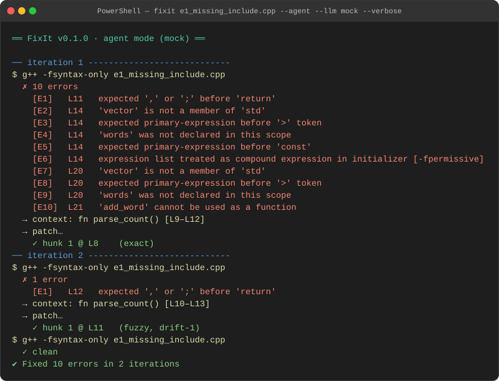
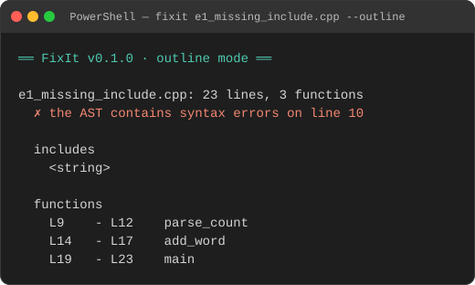
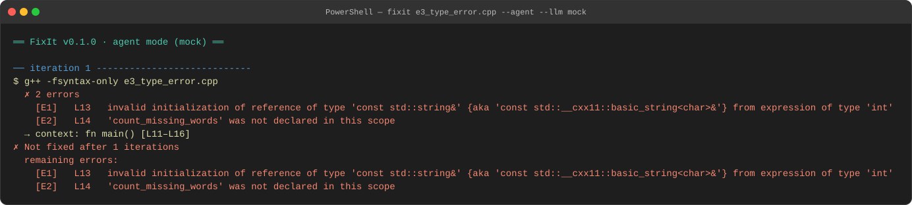
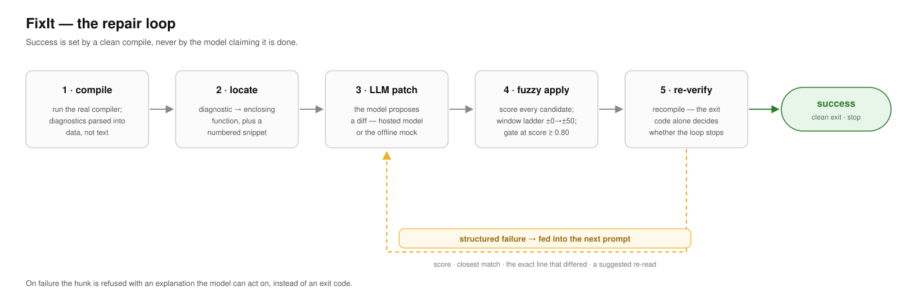
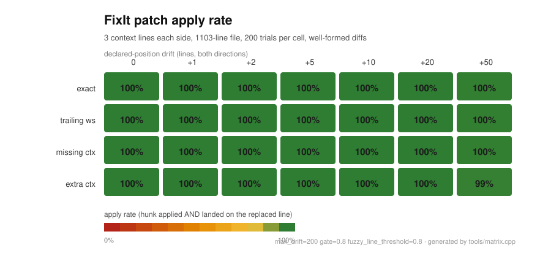
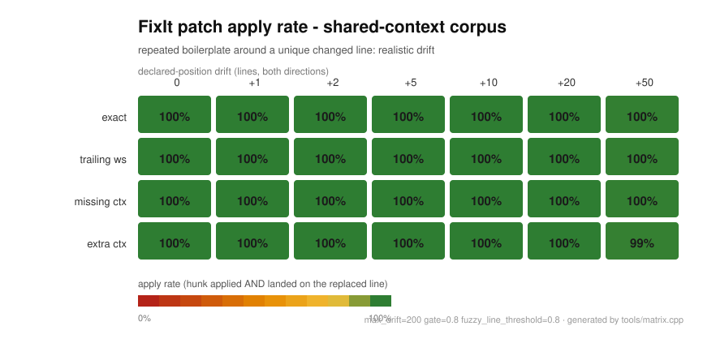
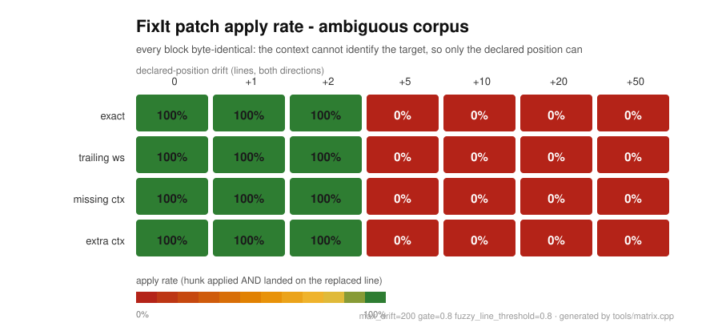

> [English](README.md) | **繁體中文**

# FixIt

[](https://github.com/wong060404/FixIt/actions/workflows/ci.yml)
[](#需求)
[](LICENSE)

**FixIt 是一個 C++ 函式庫加上 CLI 工具，閉環串接編譯器輸出與 LLM 產生的修補（patch）：
compile（編譯）→ locate（定位）→ LLM patch（LLM 修補）→ fuzzy apply（模糊套用）→ re-verify（重新驗證）。**

FixIt 不是另一個包住 `patch(1)` 的包裝工具。它的 patch 引擎是為模型*實際產生出來*的
patch 而設計——行號會漂移、上下文缺失、空白字符不太對得上——而且當一個 patch 無法
套用時，它回傳的是結構化說明，讓模型可以據以修正，而不是一個 exit code。

### 實際運作畫面

[](https://youtu.be/w3c9Fsy27VE)

**▶ [在 YouTube 觀看完整 4 分鐘介紹](https://youtu.be/w3c9Fsy27VE)** · [本機副本](docs/fixit_intro_subs.mp4) · [英文字幕](docs/fixit_intro.srt)

GitHub 不允許在 README 中嵌入 YouTube 播放器，所以上面的縮圖會開啟 YouTube 上的
影片。影片從這個專案要解決的問題開始：模型的 diff 是正確的，但 `patch(1)` 用一個
exit code 拒絕了它。下面的一切都源自於閉上這個迴圈。

> **第一次用？** 在 Windows 上，請先從
> [`WINDOWS-SETUP.md`](WINDOWS-SETUP.md)（[English](WINDOWS-SETUP.md)）開始：clone、
> 建置並修復你的第一個檔案，全程不需要任何系統層級的安裝。

### 文件

這個 repo 中每一份文字文件都有英文與繁體中文（`.zh-TW`）兩個版本。

| 文件 | English | 繁體中文 |
|---|---|---|
| Windows 入門：clone → build → 執行 → 修復一個檔案 | [WINDOWS-SETUP.md](WINDOWS-SETUP.md) | [WINDOWS-SETUP.zh-TW.md](WINDOWS-SETUP.zh-TW.md) |
| 本 README | [README.md](README.md) | [README.zh-TW.md](README.zh-TW.md) |
| 設計決策（ADR） | [docs/decisions.md](docs/decisions.md) | [docs/decisions.zh-TW.md](docs/decisions.zh-TW.md) |
| Wiki 大綱 | [docs/wiki_outline.md](docs/wiki_outline.md) | [docs/wiki_outline.zh-TW.md](docs/wiki_outline.zh-TW.md) |
| 編譯器 fixtures | [tests/fixtures/compiler/README.md](tests/fixtures/compiler/README.md) | [tests/fixtures/compiler/README.zh-TW.md](tests/fixtures/compiler/README.zh-TW.md) |
| 錄製的 demo 記錄 | [docs/demo_output.txt](docs/demo_output.txt) | —（位元組級精確的程式輸出，由測試套件斷言） |
| 介紹影片（4 分鐘，含字幕） | [YouTube](https://youtu.be/w3c9Fsy27VE) · [本機副本](docs/fixit_intro_subs.mp4) | —（英文字幕：[docs/fixit_intro.srt](docs/fixit_intro.srt)） |

---

---

## 0. 專案文件——動機、創新、使用情境、建置與使用

> 課程要求記錄專案的**動機（motivation）**、**創新（innovation）**與**範例使用
> 情境**，另加一份**建置／使用指南**。這一節就是那份摘要，放在下面的技術參考之前。
> 這裡的每一項論述都在下面的章節與 [`docs/decisions.md`](docs/decisions.md) 中有
> 詳細說明。

### 0.1 動機

Agentic C++ 修復有一個瓶頸，而它**不在**模型身上：**patch 套不進去**。模型寫出一個
合理的修改，`@@ -14,4 +14,5 @@` 因為檔案已變動而過期，`patch(1)` 便拒絕整個 diff。
模型永遠學不到*為什麼*，只能再猜一次，浪費又一輪。

| 失敗情形 | 現有工具的作法 | 迴圈需要的 |
|---|---|---|
| 行號漂移（line drift） | 拒絕該 hunk | 依內容找到該 hunk |
| 缺少上下文 | 拒絕該 hunk | 對被引用的行打計分 |
| 空白 / CRLF 雜訊 | 拒絕該 hunk | 視為可匹配 |
| 拒絕本身 | 什麼都沒有——只有一個 exit code | 指出哪一行不同、該重新讀取什麼 |

FixIt 閉上這個迴圈——**compile → locate → patch → fuzzy apply → re-verify**——並讓
失敗案例與成功案例一樣有用。只有編譯器可以宣告修復成功。

### 0.2 創新

1. **模糊 patch 引擎。** 候選位置會被打計分（`exact`/`fuzzy`/`mismatch`，正規化後
   一個完美的 hunk 是 `1.00`），並沿著階梯 `±0 → ±1 → ±2 → ±5 → ±10 → ±50 → global`
   搜尋，門檻為 `score ≥ 0.80` **且**至少有一行完全一致。即使行號漂移、缺少上下文、
   結尾有空白差異，patch 依然能套用。
2. **回傳給模型的結構化失敗。** 被拒絕的 patch 會回報計分值、門檻、最接近的匹配、
   實際不同的那一行，以及建議重新讀取的範圍——這段文字是為貼進下一個 prompt 而設計的。
3. **編譯器是唯一的事實標準（ground truth）。** 模型回 `FINAL` 仍會觸發編譯；
   `success` 只來自一個真正執行過的編譯器的乾淨退出。
4. **敵對環境的強化。** 所有 flag 都是先探測、不做假設（GCC 沒有 `-ferror-limit`）；
   clang/GCC 的診斷訊息會先正規化；路徑從 `argv` 到檔案系統一律 UTF-8，因此中文檔名
   與中文 checkout 路徑都能運作；CRLF 檔案在編輯後仍維持一致的 CRLF。
5. **是函式庫，不只是工具。** `libfixit` 可安裝並以 `FixIt::fixit` 匯出；CI bot 可以
   link `Compiler` + `PatchEngine`，編輯器可以用 `CodeMap`，agent 產品可以直接使用
   完整的 `Agent`。

實測效果（每格 200 次試驗，合成語料掃描）：在「每行都獨特」的語料上，引擎對宣告位置
漂移達 **±20 行**以內的 diff 套用率為 **100%**；當每個區塊位元組級相同時，±2 行以外
則是 **0%**——這是誠實的極限，我們把它寫下來，而不是藏起來（見 §8a）。

### 0.3 使用情境範例

* **除錯自己檔案的學生** — `fixit.cmd lab3.cpp` 執行真正的編譯器，並把每個錯誤對應到
  它所在的外層函式；`--outline` 不需編譯即可列出函式與 includes。
* **修復編譯不過的檔案** —
  `fixit.cmd lab3.cpp --agent --llm mock --verbose --no-write` 會修復一份暫存副本，
  並重新編譯來證明；把 `--llm openai --base-url http://127.0.0.1:11434/v1` 指向本機
  模型，即可修復任意 bug。
* **CI 修復 bot** — exit code 就是合約（`0` 已修復、`1` 仍壞、`2` 用法錯誤），
  `--trace` / `--metrics` 會記錄嘗試過的內容。
* **編輯器或 IDE 外掛** — `CodeMap::enclosing_function(line, col)` 不需要編譯器
  也不需要模型。
* **需要可靠編輯工具的 LLM agent** — 呼叫 `PatchEngine::apply` 並把 `failure_summary()`
  餵回去；[`examples/consumer/`](examples/consumer/) 是一個完整、可建置的範例。
* **評量任何模型的 patch 品質** — `fixit-matrix` 掃描受控的瑕疵條件，並印出每一格的
  成功率。

### 0.4 建置與使用

**Windows（無需任何系統層級的安裝）：**

```powershell
git clone https://github.com/wong060404/FixIt.git
cd FixIt
.\setup.cmd        # 每台機器執行一次：編譯器、建置、把 `fixit` 放上 PATH
# 開啟新的 terminal，之後在任何資料夾都可執行：
fixit.cmd lab3.cpp --agent --llm mock --verbose --no-write
```

`setup.cmd` 會尋找已安裝的編譯器（或用 `-FetchToolchain` 下載可攜式 MinGW-w64 GCC），
建置到 git-ignored 的 `build-win/`，把 `fixit` 註冊到使用者的 `PATH`，並做驗證。
`--no-write` 會修復一份私人副本，原檔不受影響；不加 `--agent` 時工具只編譯一次並列出
診斷訊息。

**Linux / macOS：**

```bash
cmake -B build -DCMAKE_BUILD_TYPE=Release && cmake --build build -j
ctest --test-dir build --output-on-failure        # or: tools/test_all.sh
./build/bin/fixit examples/buggy/e1_missing_include.cpp --agent --llm mock --verbose
```

**Exit codes：** `0` 乾淨或已修復 · `1` 未修復 · `2` 用法錯誤／檔案讀不到／沒有
API key · `3` 內部錯誤 · `127` 無法執行編譯器。
逐步指南（含每一步的預期輸出）見 §3（快速開始）、§6.7（CLI）與
[`WINDOWS-SETUP.md`](WINDOWS-SETUP.md)。

### 0.5 實際執行畫面

以下是 **真實執行** 在 Windows（MSYS2 GCC 16.1.0）上的畫面——文字是程式本身的輸出，
不是模擬圖。

**修復。** 兩個刻意植入的 bug（缺 `;` 與缺 `<vector>`）在兩輪內修好。第二個 hunk
宣告的位置低了一行，仍然套對（`fuzzy, drift-1`）；最後的 `✓ clean` 是真正重新編譯
的結果。



**不編譯就看結構。** `--outline` 列出函式、includes 與有語法錯誤的行——在動一個不熟
的檔案之前很有用。



**誠實的失敗。** `e3_type_error.cpp` 在 mock 規則之外，所以 FixIt 照實說明、列出剩餘
錯誤並以 `1` 退出，而不是裝成修好了。



---

## 1. 是什麼、為什麼

Agentic C++ 修復有一個瓶頸，不在模型身上：**patch 套不進去。** 模型寫出一個完全合理
的修改，`@@ -14,4 +14,5 @@` 因為檔案變動而偏了两行，`patch(1)` 拒絕整個 diff。模型
永遠學不到*為什麼*，只能再猜一次，浪費又一輪。

FixIt 閉上這個圈：

| 步驟 | FixIt 做的事 |
|---|---|
| compile | 執行真正的編譯器，把診斷訊息解析成資料（不是文字） |
| locate | 把診斷訊息對應到所在的外層函式與帶行號的片段 |
| patch | 用滑動視窗對每個可能位置打計分，套用最佳的一個 |
| re-verify | 重新編譯；只有編譯器決定修復是否成功 |
| on failure | 回傳 `score`、最接近的匹配、實際不同的那一行，以及建議重新讀取的範圍 |



## 2. 創新

1. **模糊 patch 引擎。** 每個候選位置都會打計分（`exact`/`fuzzy`/`mismatch`，
   正規化後完美的 hunk 是 `1.00`），沿著視窗階梯 `±0 → ±1 → ±2 → ±5 → ±10 → ±50 →
   global` 搜尋，門檻為 `score ≥ 0.80` 且至少有一行完全一致。行號漂移、缺少上下文、
   結尾空白差異都能照常套用。
2. **回灌迴圈的結構化失敗。** 被拒絕的 hunk 會產出
   `score 0.55 < gate 0.80 … expected line 14 to contain 'return x;' but the
   file has 'return 0;'. Closest match at line 15 … re-read lines 12-18`——這段
   文字就是為直接貼回下一個 prompt 而設計的。
3. **編譯器是唯一的事實標準。** 回答 `FINAL` 的模型仍會觸發編譯；`success` 只由乾淨
   退出設定。mock 規則、trace 格式與 CLI 全部讀取同一個來源。

## 3. 快速開始

```bash
git clone https://github.com/wong060404/FixIt.git
cd FixIt
cmake -B build -DCMAKE_BUILD_TYPE=Release && cmake --build build -j && ctest --test-dir build --output-on-failure
```

> **Windows：** 不需要任何系統層級的安裝。`python tools\windows\fetch_mingw.py` 會
> 下載可攜式 MinGW-w64 GCC，`tools\windows\build_fixit.ps1` 不用 CMake 就能建置出同樣
> 的兩個 binary（CMake 的 generator 在這裡不能用——原因見該 script 的檔頭）。逐步指南
> 請看 [`WINDOWS-SETUP.md`](WINDOWS-SETUP.md)（或中文版
> [`WINDOWS-SETUP.zh-TW.md`](WINDOWS-SETUP.zh-TW.md)），從一台乾淨的 Windows 機器開始，
> 到修復完成為止，可用本機模型或你自己的 OpenAI-compatible endpoint。兩個輔助腳本覆蓋
> 模型後端：`tools\windows\llm-relay.py` 讓這個沒有 TLS 的 build 能連 https endpoint；
> `tools\windows\probe-endpoint.py` 在執行前檢查 endpoint、key 與模型。

Windows 上還有一條更短的路，不需要 CMake 也不需要預備環境：
`.\fixit.ps1 <file> [options]`（或在 `cmd.exe` 裡用 `fixit.cmd`）首次使用時會自行建置
工具、自行尋找已安裝的編譯器，並把每個參數原樣轉發，所以一個普通的 clone 就能直接跑。
見 [`WINDOWS-SETUP.md`](WINDOWS-SETUP.md#fast-path--a-clone-that-builds-itself)。

接著執行第 0 節的驗收命令：

```bash
./build/bin/fixit examples/buggy/e1_missing_include.cpp --agent --llm mock --verbose
```

預期結果：§4 的記錄與 exit code `0`。這條路徑完全不碰網路。

該命令會原地修復範例。加上 `--no-write` 就改為修復一份暫存副本、讓工作區保持位元組級
不變——CI smoke test 用的就是這個方式（`tools/record_demo.sh` 也是靠對暫存副本執行
達成），所以兩者隨時都可以重跑。

`--llm mock` 是內建的離線模型：它修復兩種特定故障形態，是測試套件與 demo 使用的
後端。要用自己的模型修復任意程式碼，見 §6.6（透過 https 使用真正的模型）；要修復
包含專案 header 的檔案，見 §6.5。

### 需求

* **CMake ≥ 3.20，已安裝且在 `PATH` 上。** 建置無法自己引導建置系統：缺 `cmake` 就
  先裝（例如 `brew install cmake`，或 `pip install cmake` 再把它的 `bin/` 放上 `PATH`
  ——pip 裝的 CMake 可以用，但前提是能找到 `cmake` 指令）。
* 一個 C++20 編譯器：gcc 12 / clang 15 或更新。macOS 上 `clang++` 沒問題；注意
  Apple clang 的 build 沒有 JSON 診斷輸出，FixIt 會偵測到並自動回退（ADR-007）。
* Python ≥ 3.8 只給重新產生物件的維護腳本用（`tools/gen_golden_cases.py`、
  `tools/render_heatmap.py`、`tools/gen_expected.sh`）。測試套件本身從不调用 Python。

相依套件來自 `third_party/` 內的 vendored snapshot；缺少它的 checkout（例如只有
原始碼的 tarball）會回退到 `FetchContent`、拉取釘選的上游版本，這需要在 configure
時有網路。兩條路徑都有測試、都能建置。

驗證那個回退途徑時學到兩件事：

* 釘選的版本與 snapshot 完全一致，包括 tree-sitter 的 commit SHA——上游尚未 tag
  0.28.0（最新 tag 是 v0.27.0），所以用 tag 會悄悄拉到不同的程式碼。要升版就同時升
  snapshot 與 pin。
* `FetchContent` 會從原始碼建置 cpp-httplib，它的 CMake 會找可選的壓縮函式庫。如果
  你機器上的套件管理器提供了不同架構的 zstd/OpenSSL，configure 會找到它、然後 link
  失敗：`ignoring file … found architecture 'x86_64', required architecture 'arm64'`。
  把 CMake 指開：`-DCMAKE_IGNORE_PATH=/opt/anaconda3`（或那棵樹所在的地方）。vendored
  snapshot 的建置不受影響。

### 在 VS Code 中建置與除錯

已 commit 的 `.vscode/` 資料夾是為這個 CMake 專案設好的，所以 `F5` 會先用 CMake 建置、
再用 lldb 除錯 `build/bin/*`：

| 操作 | 作法 |
| --- | --- |
| 建置全部 | `Cmd+Shift+B`（task `cmake: build`） |
| 對目前開啟的檔案除錯 CLI | `F5` → `fixit CLI：對目前檔案跑 --outline（mock LLM）` |
| 除錯測試 binary | `F5` → `測試：compiler.test`（每個測試 binary 一筆） |
| 跑完整套件 | task `test: 全部 ctest` |
| 重新產出 build 目錄 | task `cmake: configure` |

這台機器沒有系統層級安裝 `cmake`；task 與 CMake Tools 整合都指向附帶的副本
`../.buildtools/cmake/data/bin/cmake`。

**不要用 `C/C++: 建置使用中檔案` 除錯。** 那個自動生成的 task 是把單一 `.cpp` 單獨
編譯，在這裡行不通：

* `src/*.cpp` 與 `tests/*.cpp` 需要 CMake 提供的 include 路徑（Catch2、tree-sitter、
  `httplib`），單獨 `clang++ file.cpp` 會以 `'catch2/catch_test_macros.hpp' file not
  found` 失敗。
* `examples/buggy/e1`–`e3` 是**故意壞掉的** fixture——編譯失敗就是它設計好的行為，
  不是環境問題。`e4_testing.cpp` 是手動測試留下的暫存檔；它能乾淨編譯，且沒有任何
  測試或 demo 引用它。

如果 `F5` 報 *"Errors exist after running preLaunchTask"*，跑一次 `cmake: build` 並讀
編譯輸出：那是真正的編譯器錯誤，或者你單獨編譯了不該單獨編譯的檔案。

**沒有 CMake 的 Windows** 用 `windows:` 開頭的 task：`windows: build (build-win, no
CMake)` 跑專案自己的建置腳本，三個 `windows: run fixit …` task 則從
`build-win/bin/fixit.exe` 對目前檔案執行 CLI。它們不需要 CMake、不需要 generator、
`PATH` 上也不要有 `cmake`。F5 除錯仍然需要 `gdb`（MSYS2 裡
`pacman -S mingw-w64-ucrt-x86_64-gdb`）與一個指向 `build-win/bin/fixit.exe` 的
launch entry。

## 4. Demo 記錄

錄自真實執行；完整記錄（含全部三個範例與每條診斷訊息）在
[`docs/demo_output.txt`](docs/demo_output.txt)。

```
$ fixit e1_missing_include.cpp --agent --llm mock --verbose --compiler clang++

══ FixIt v0.1.0 · agent mode (mock) ══

── iteration 1 ----------------------------
$ clang++ -fsyntax-only e1_missing_include.cpp
  ✗ 5 errors
    [E1]   L10   expected ';' at end of declaration
    [E2]   L14   no member named 'vector' in namespace 'std'
    [E3]   L14   expected '(' for function-style cast or type construction
    [E4]   L14   use of undeclared identifier 'words'
    [E5]   L14   expected expression
  → context: fn parse_count() [L9–L12]
  → patch…
    ✓ hunk 1 @ L8    (exact)
── iteration 2 ----------------------------
$ clang++ -fsyntax-only e1_missing_include.cpp
  ✗ 1 error
    [E1]   L11   expected ';' at end of declaration
  → context: fn parse_count() [L10–L13]
  → patch…
    ✓ hunk 1 @ L11   (fuzzy, drift-1)
$ clang++ -fsyntax-only e1_missing_include.cpp
  ✓ clean
✔ Fixed 5 errors in 2 iterations
```

兩個 hunk 就是兩個植入的 bug：缺分號（第 10 行）與從未 include 的 `<vector>`。第一個
精確套中；第二個宣告位置偏了一行——對搜尋來說這不重要，視窗搜尋會找到它。
`e2_drift.cpp` 把同樣兩個 bug 放在往下 37 行的地方，因此*兩個*宣告位置都是錯的，
搜尋依然修復成功。`e3_type_error.cpp` 刻意放在 mock 規則集之外：迴圈照實回報未修復
（exit `1`），而不是裝成修好了；它是給真正模型用的 fixture。

該記錄由 `tools/record_demo.sh` 重新產出，且可位元組級重現（`--no-timing`、
`NO_COLOR=1`），CI 因此可以 diff 它。

## 5. 架構

```
              ┌──────────────────────── fixit-cli ────────────────────────┐
              │  parse args · verbose transcript · --trace · --metrics    │
              └───────────────┬───────────────────────────────────────────┘
                              │
                      ┌───────▼────────┐        structured events
                      │  fixit::Agent  │◄────── Compile / Patch observations
                      └───┬────────┬───┘
        tool calls        │        │        messages + tool schemas
      ┌───────────────────┘        └────────────────────┐
      │                                                 │
┌─────▼──────────┐  ┌──────────────┐  ┌──────────┐  ┌───▼─────────┐
│ ToolRegistry   │  │ CodeMap      │  │ Compiler │  │ Llm         │
│ compile        │  │ tree-sitter  │  │ g++ /    │  │ ├ MockLlm   │
│ read           │  │ · functions  │  │ clang++  │  │ └ OpenAiLlm │
│ patch ─────────┼─►│ · includes   │  │ JSON or  │  │  (httplib)  │
└────────────────┘  │ · snippets   │  │ text     │  └─────────────┘
                    └──────────────┘  └──────────┘
                            │
                    ┌───────▼────────┐
                    │  PatchEngine   │  scoring · sliding window · gate
                    │  (the core)    │  structured failure reports
                    └────────────────┘
```

`Agent` 以下全是普通的函式庫：link `libfixit` 後自己驅動迴圈，或單獨重用
`PatchEngine`，讓*別人的* diff 也能套用。

## 6. 模組

### 6.1 `fixit::Compiler` — [`include/fixit/compiler.h`](include/fixit/compiler.h)

```cpp
struct CompilerConfig {
  std::string compiler = "g++";
  int error_limit = 5;
  int timeout_seconds = 30;
  std::vector<std::string> extra_flags;
  DiagnosticFormat format = DiagnosticFormat::Auto;  // Auto | Text | Json
};

Compiler compiler(CompilerConfig{.compiler = "clang++"});
CompileResult result = compiler.compile("src/parse_config.cpp");
```

* 透過 `fork`/`exec` 執行 `<compiler> -std=c++20 -fsyntax-only [probed flags]
  [extra flags] <file>`，stdout 與 stderr 合併到同一支 pipe。
* **每個可選 flag 都是探測出來的，從不做假設——連「依編譯器名稱判斷」也不行。**
  會依序嘗試 `-fjson-diagnostics` 與 `-fdiagnostics-format=json`，文字解析器是後備，
  所以怪異的 clang 會降級而不是丟掉所有診斷訊息。`-ferror-limit=N` 只在編譯器接受時
  才傳：GCC 沒有對應 flag，傳了會直接退出（ADR-024）。`CompilerConfig::format` 可以
  強制指定解析器；強制文字解析器時同時會停發 JSON flag——否則編譯器會輸出 JSON、
  被文字解析器讀成零條診斷。專案 flag 用 `-I`/`-D`/`--flag` 傳入（見 §6.5）。
* 診斷訊息依 `(file, line, col, message)` 排序、去重、上限 50 條。
  `CompileResult::clean()` 是迴圈的事實標準。
* 逾時時殺掉子程式，並保留到目前為止抓到的輸出（`timed_out == true`）。

### 6.2 `fixit::CodeMap` — [`include/fixit/codemap.h`](include/fixit/codemap.h)

```cpp
CodeMap map("src/parse_config.cpp");
map.functions();                       // {name, signature, start_line, end_line}
map.enclosing_function(14, 5);         // innermost function containing the caret
map.includes();                        // {"<cstdio>", "\"local.h\""}
map.context_snippet(14, 12);           //   13 |   ...
map.has_syntax_errors();
```

`signature` 是定義第一行起、到（不含）函式體 `{` 為止的宣告文字。`context_snippet`
的格式是 `%4d | text`、會 clamp 在檔案範圍內——正是模型可以直接引用的形狀。檔案不存在
或無法解析時永遠不丟例外：map 降級運作，`has_syntax_errors()` 回傳 `true`。

### 6.3 `fixit::PatchEngine` — [`include/fixit/patch.h`](include/fixit/patch.h) ★

```cpp
PatchEngine engine;  // PatchConfig{max_drift=200, fuzzy_line_threshold=0.8, gate=0.8}
PatchResult result = engine.apply(file_content, unified_diff, "parse_config.cpp");
result.all_applied;        // every hunk passed the gate
result.new_content;        // applied hunks written, refused hunks untouched
result.reports;            // per-hunk status, score, positions, top candidates
result.failure_summary();  // ready to feed back to the model
```

候選位置 `p` 的計分：

```
exact(p)    = signature lines equal after trailing-whitespace normalisation
fuzzy(p)    = lines not exactly equal but Levenshtein ratio >= 0.8
mismatch(p) = everything else
score(p)    = (0.6*exact + 0.3*fuzzy - 0.2*mismatch) / (0.6 * signature.size())
```

分母用「能達到的最佳原始分」正規化，使完美 hunk 是 `1.00`、文件裡的 `gate = 0.8`
有意義（見 [`docs/decisions.md`](docs/decisions.md) ADR-002——原題目裡的公式最高只有
`0.60`，連自己的門檻都過不了）。hunk 只有在 `score >= gate` **且** `exact >= 1` 時才
套用；在 `±0` 內命中是 `Applied`，其他都是 `FuzzyApplied`。

失敗輸出長這樣，而它就是重點：

```
Patch failed for parse_config.cpp:
- Hunk 1: APPLIED @ line 8 (exact, score 1.00)
- Hunk 2: FAILED (score 0.55 < gate 0.80. Declared position line 14 but the
  closest match is line 15 (score 0.70, exact 1/3). Window tried: +/-0..+/-200 plus global scan
  plus global scan. Context mismatch: expected line 15 to contain 'return x;'
  but the file has 'return 0;'). Closest match at line 15
  Suggested fix: re-read lines 12-18 and retry with corrected context.
```

### 6.4 `fixit::Agent` — [`include/fixit/agent.h`](include/fixit/agent.h)

```cpp
Agent agent(make_standard_tools(workdir), std::make_unique<MockLlm>(),
            Compiler(CompilerConfig{.compiler = "g++"}), workdir);
agent.set_trace_path("trace.json");
agent.set_observer([](const Agent::Event& event) { /* live progress */ });
AgentResult result = agent.run("parse_config.cpp", /*max_iterations=*/4);
```

三個標準工具放在 `make_standard_tools`，任何額外的工具都只是另一次
`ToolRegistry::add`：

| Tool | Arguments | Returns |
|---|---|---|
| `compile` | `{file}` | 診斷訊息（資料格式），若編譯器有輸出，附上它自己的 `raw_output` |
| `read` | `{file, start, end, outline?}` | 帶行號的列區間（含端點、1 起始）與 CodeMap `outline`（函式、includes、語法錯誤行）——`outline` 預設開啟 |
| `patch` | `{file, diff}` | 每個 hunk 一份報告（`status`、`declared_pos`、`matched_pos`、`score`）；若什麼都解析不出來，回傳解析失敗原因與收到的 diff |

`read` 與 `patch` 把所有路徑解析在 agent 的 workdir 內：絕對路徑與 `..` 會被拒絕，
因為 read 的結果會轉發給遠端模型，而 `patch` 也透過同一個 resolver 寫入。

`MockLlm` 是規則式、離線的；它產出 patch 時刻意宣告錯的行（`+1`），所以每個 demo
都同時跑過模糊套用路徑。`OpenAiLlm` 透過 `cpp-httplib` 說
`/v1/chat/completions`，並送出一个格式正確的對話：帶 `tool_calls` 的 assistant turn
也會包含在內，每個工具結果都引用它的 `tool_call_id`，因此嚴格的 server 不會拒絕
第二輪。

### 6.5 修復包含專案 header 的檔案

`fixit` 自己啟動編譯器，所以包含專案 header 的檔案必須告訴它 header 在哪裡：

```bash
./build/bin/fixit src/parser.cpp -Iinclude -Ithird_party/lib -DDEBUG=1 --agent --llm mock
```

`-I DIR` / `--include DIR`、`-D NAME[=VALUE]` 與 `--flag FLAG` 會原樣傳給編譯器，
且可重複使用；合併寫法 `-Iinclude` 也行。回顯的命令列顯示實際執行的內容：

```
$ g++ -std=c++20 -fsyntax-only -Iinclude src/parser.cpp
```

沒這些 flag，編譯器會停在 `'x.h' file not found`，根本到不了真正的錯誤。最省事的
習慣：從你平常編譯的目錄執行 `fixit`，帶上你已經在用的 `-I` flag；或讓
`compile_commands.json` 告訴你該用哪些。

### 6.6 透過 https 使用真正的模型

預設 build 沒有 TLS，因為 OpenSSL 不在四個允許的相依套件之中。所以 `https://`
endpoint 需要一個啟用 TLS 的 build：

```bash
cmake -B build-tls -DCMAKE_BUILD_TYPE=Release -DFIXIT_ENABLE_OPENSSL=ON
cmake --build build-tls -j
```

`find_package(OpenSSL)` 會找到系統 OpenSSL。有兩個 macOS 的細節值得知道，都是這個
專案吃過虧才學到的：

* 在 Apple 機器上，cpp-httplib 從 **Keychain** 讀取 trust store，需要 `CoreFoundation`
  與 `Security`；build 會自動 link 它們。傳 `-DFIXIT_MACOS_KEYCHAIN_CERTS=OFF` 可改用
  CA bundle。
* 系統 OpenSSL **不會**讀 Keychain，所以即使是有效的 Let's Encrypt 憑證，`https://`
  仍會失敗並報 `SSL server verification failed`。因此 `OpenAiLlm` 明確把 OpenSSL 指到
  一個 bundle：有設 `$FIXIT_CA_BUNDLE` 就用它，macOS 上否則用 `/etc/ssl/cert.pem`
  （macOS 為自己的 curl 附帶的 bundle），再否則用慣用的 Linux 路徑。驗證永不關閉。

接著對任何 OpenAI-compatible endpoint 執行：

```bash
export FIXIT_API_KEY=sk-...          # 或：--api-key

./build-tls/bin/fixit your_file.cpp --agent --llm openai \
  --base-url https://your-endpoint/v1 \
  --model your-model --verbose --no-write
```

`tools/fixit_with_my_key.sh` 為專案本地的設定包裝了這段流程：key 從 `$FIXIT_API_KEY`
或 git-ignored 的 `.secrets/fixit_key` 讀取，絕不出現在 `argv`（因此不會出現在 `ps`
輸出或 log 裡），並在子程序執行前 unexport，使任何 trace 或 metrics 檔都不含它。

### 6.7 CLI

```
fixit <file.cpp> [--agent] [--llm mock|openai] [--model NAME]
      [--base-url URL] [--api-key KEY | env FIXIT_API_KEY]
      [--iterations N] [--verbose] [--trace PATH] [--metrics PATH]
      [--compiler NAME] [--no-write] [--no-timing] [--outline]
      [-I DIR | --include DIR]... [-D NAME[=VALUE]]... [--flag FLAG]...
```

預設值：`--llm mock`、`--model gpt-4o-mini`、`--base-url https://api.openai.com/v1`、
`--iterations 4`、`--compiler g++`。`--define` 是 `-D` 的同義參數；`-h`/`--help`
印出與本節相同的文字。

沒有 `--agent` 時只編譯一次並印出診斷訊息。Exit codes：

| Code | Meaning |
|---|---|
| `0` | 乾淨，或已修復並重新驗證為乾淨 |
| `1` | 未修復（會列出剩餘錯誤） |
| `2` | 用法錯誤、檔案讀不到，或 `--llm openai` 沒有 key |
| `3` | 內部錯誤（非預期的例外；是後備保護，不是常規路徑） |

`--no-timing` 省略實際時間回報，讓輸出可以在多次執行之間 diff——
[`docs/demo_output.txt`](docs/demo_output.txt) 位元組級可重現就是靠它。stdout 不是
TTY 或設了 `NO_COLOR` 時會關閉 ANSI 顏色，同樣為了讓那個檔案可 diff。

### 6.8 一個值得知道的 regression

一個**插入**行、同時引用周圍上下文的 hunk，過去會多吃掉檔案的一行，靜默刪除插入點
後面的那一行。它不是被 golden 語料抓出來的，而是用真正的模型驅動引擎時才找到——所有
生成的案例都是「替換行」，沒有任何一個同時包含引用上下文與新增行。

套用路徑現在從 hunk 的舊側（context 加上要刪除的行）推導被替換的範圍，只有當 header
宣告的計數*更大*時才向外擴張——那正是 header 存在的理由。
`tests/patch_golden.test.cpp` 的 `[patch][regression]` 涵蓋它；ADR-028 記錄了這個
缺陷、兩次被撤回的嘗試，以及最終的修正。

## 7. 測試

```bash
ctest --test-dir build --output-on-failure
```

| Suite | 內容 |
|---|---|
| `patch_golden.test` | **60 個 golden patch**（10 精確、10 行號漂移、10 空白差異、10 缺上下文、10 多餘上下文、10 多 hunk），斷言 `all_applied` 與位元組級精確的輸出；另有 **10 個反例**，斷言被拒絕、內容未動、`failure_reason` 包含計分值、門檻、視窗與出錯的那一行；還包含插入／刪除的 round-trip，以及「插入 hunk 過去會吃掉下一行」的 regression |
| `compiler.test` | 20 個 fixture（錄製的 clang 輸出 + GCC 格式輸出）；針對刻意寫好的來源做 gcc/clang **一致性（parity）**檢查、逐行斷言一致；以及對 `e1`–`e3` 的結構性檢查（兩者都宣告檔案壞掉、第一條 anchor 在兩行內、兩者都點名植入的故障）——因為對刻意壞掉的輸入，跨編譯器的逐行一致根本不可能達成（ADR-023/025） |
| `codemap.test` | 五個樣本檔案：函式列表、最內層 `enclosing_function`、逐字 includes、片段格式與 clamp、語法錯誤、檔案不存在 |
| `agent_mock.test` | 在 `e1`/`e2` 上的完整迴圈（成功、乾淨編譯、patch 報告）、`e3` 未修復但不崩潰、trace schema、重複執行位元組級一致、工具分派與 sandboxing、以及無法使用的編譯器在單輪內失敗 |
| `expected_artifacts.test` | `examples/buggy/expected/` 與即時 mock 執行比對；commit 的 demo 記錄不含計時 |
| `cli_contract.test` | binary 的可觀察行為：exit code、用法錯誤、目錄被拒絕而不是「編譯乾淨」、`--outline`、`--no-write` 讓檔案保持位元組級不變、`--no-timing`、以及 `-I`/`-D`/`--flag` 確實傳到編譯器 |

golden 案例由 [`tools/gen_golden_cases.py`](tools/gen_golden_cases.py) 生成到
`tests/patch_golden_cases.inc`（已 commit）——C++ 套件永遠不需要 Python。

每個測試都離線且確定性：`MockLlm` 沒有任何 I/O，整合測試斷言同一輸入的兩次執行
產生位元組級相同的 trace。

## 8. 可重用性論證

> tree-sitter-cpp 只能解析、cpp-httplib 只能送 HTTP、diffutils 只能機械式套用 diff。
> **沒有現成 C++ 庫能閉環「compiler diagnostics → code location → LLM patch →
> fuzzy apply → re-verify」並把失敗原因結構化回傳給 LLM**。FixIt 補上這層，任何
> agentic coding 工具（CI 修復 bot、IDE 插件）可直接 link。

具體來說，`libfixit` 是一個普通的 CMake target，介面像 header-only
（`include/fixit/*.h`）、沒有全域狀態、不依賴 CLI：`add_subdirectory` 再 link 即可。
CI 修復 bot 可以只用 `Compiler` + `PatchEngine`，IDE 外掛可以只用 `CodeMap`，
agent 產品可以直接拿完整的 `Agent`。安裝函式庫、匯出、附 package config 這幾件事是
*刻意還沒做*的——列在 roadmap 上。

## 8a. 實測效果

`./build/bin/fixit-matrix` 掃描格式正確、瑕疵受控的 diff；
`python3 tools/render_heatmap.py` 把結果轉成 `docs/` 下的熱力圖。目前數字（每格 200
次試驗）：

| Corpus | Drift tolerance |
|---|---|
| 每行都獨特、3 行 context | 漂移 **±20 行以內 100%**，±50 為 99% |
| 真實樣板碼（`}`、空行、近乎相同的函式體） | ±20 以內 **100%**，±50 為 99% |
| 每個區塊位元組級相同 | ±2 以內 100%，**±5 以外 0%** |

每一行都同時包含四種瑕疵——精確、結尾空白、缺上下文、多餘上下文——所以每一格就是
「該瑕疵 × 該漂移」下的套用率。

同樣數字畫成熱力圖：行是四種瑕疵，欄是宣告位置的漂移量，每格 200 次試驗。

**每行都獨特、3 行 context**——專案的主張



**唯一改動行周圍的重複樣板碼**——真實的漂移



**每個區塊位元組級相同**——誠實的極限



前兩行是專案的主張；第三行是它的誠實極限：當上下文與好幾個位置同樣匹配、*而且*
宣告位置是錯的，沒有任何演算法能恢復意圖——FixIt 會套用最接近的候選，掃描把它記為
失敗。見 [`docs/wiki_outline.md`](docs/wiki_outline.md) 與
[`docs/patch_success_matrix.json`](docs/patch_success_matrix.json)。

## 9. 路線圖

* **對 hosted 模型發表正式評估。** 測試台已能對真正的 OpenAI-compatible endpoint
  端到端運作（見 §6.6），但 §8a 的數字來自合成掃描、不來自模型。把 fixture 集（包括
  mock 刻意拒絕的 `e3`）丟給 hosted 模型跑，缺的是證據、不是管線。
* **多檔專案** — `PatchEngine::parse_diff` 已經會回傳多個 `DiffFile`，`Agent` 也能
  patch 其中任何一個；缺的是產出整個 target 逐檔診斷的建置系統轉接器。讀
  `compile_commands.json` 也能免去手動傳 `-I`。
* **打包（Packaging）** — `install()`/export rules 與 package config，接著是
  vcpkg/Conan recipe，讓使用者不需要自己建置 tree-sitter。
* **Demo 影片** — [已發布到 YouTube](https://youtu.be/w3c9Fsy27VE)
  （[本機副本](docs/fixit_intro_subs.mp4)）。它由同一份錄製記錄生成，因此不會與
  `docs/demo_output.txt` 走樣。

## 目錄結構

```
fixit/
├── fixit.ps1, fixit.cmd                # Windows 啟動器：首次使用自動建置，無需設定
├── include/fixit/{compiler,codemap,patch,agent,types}.h
├── src/{compiler,codemap,patch,agent,openai_llm,mock_llm}.cpp
├── tools/fixit-cli/main.cpp
├── tools/windows/{build_fixit.ps1,fixit-env.ps1,fetch_mingw.py,llm-relay.py,
│                probe-endpoint.py,run-real-loop.ps1}
├── tools/matrix.cpp                     # §8a 背後的掃描
├── tools/{gen_golden_cases.py,render_heatmap.py,gcc_sim.py,summarise_trace.py}
├── tools/{record_demo.sh,gen_expected.sh,record_compiler_fixtures.sh}
├── tools/{fixit_with_my_key.sh,push_to_github.sh}
├── tests/{patch_golden,compiler,codemap,agent_mock,expected_artifacts,cli_contract}.test.cpp
├── tests/fixtures/{compiler,codemap}/
├── examples/buggy/{e1_missing_include,e2_drift,e3_type_error}.cpp
├── examples/buggy/e4_testing.cpp       # 手動測試的暫存檔；不是 fixture
├── examples/buggy/expected/             # 修復後內容 + trajectories
├── docs/{decisions.md,demo_output.txt,patch_success_matrix.json,wiki_outline.md}
├── docs/patch_success_heatmap*.svg      # 由 matrix 渲染的三張熱力圖
├── .github/workflows/ci.yml
├── .secrets/                            # git-ignored；真正 endpoint 的 API key
└── third_party/                         # 釘選的 snapshot；FetchContent 回退
```

## 設計決策

原題目中每處含糊之處都已解決並記錄在 [`docs/decisions.md`](docs/decisions.md)
（ADR 格式：context / decision / rationale）——計分正規化、視窗階梯、部分套用
（partial-apply）語義、mock 的刻意漂移、相依套件釘選、API key 政策，以及平台
注意事項。
